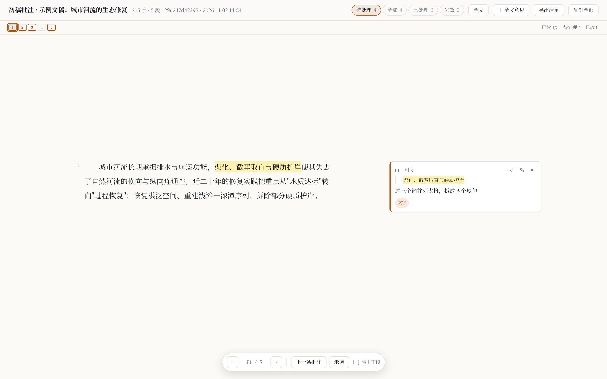

# web-margin-notes

[](LICENSE)

Word-style margin comments for any Markdown draft — as a local web page an author can annotate, and a JSON file an AI agent can read and act on.

作者在网页上对着稿子划词写意见（像 Word 的边注）；代理人直接读同一份 `notes.json`，按条改稿、回写状态。Flask + 原生 JS，**无 npm、无构建、无云端依赖**。



## Why

长稿（专著章节、论文、方案、PLAN）改起来最难的不是改，是**记住改到哪了**：

- 划词批注，边注卡片与正文像素级对齐；
- 默认**逐段模式**：一屏只有当前段和它自己的批注，`j`/`k` 翻段；
- 段落地图：橙=有批注、灰=已读、绿=已改，点格跳段；
- 批注锚定用 `quote + prefix + suffix + 段号`，**改稿后仍能定位**（exact → relocated → fuzzy → orphan 四级回退）；
- 代理人改完写一句"改法"，页面绿框显示，回看即知改动落在哪。

## Quick start

```bash
git clone https://github.com/JiangXingChi/web-margin-notes.git
cd web-margin-notes

# 生成一个实例：目标目录、要批注的 md、端口
bash scripts/scaffold.sh ~/my-review ~/docs/chapter1.md 5178
cd ~/my-review && bash start.sh
# 打开 http://127.0.0.1:5178/
```

需要 Python 3 与 Flask（`pip install flask`）。`scaffold.sh` 只复制 `templates/`，不会覆盖已存在的目录。

## Use as an agent skill

`SKILL.md` 是给 AI 代理人看的操作手册（Pi / Claude Code 等支持 SKILL.md 的运行时可直接加载）。它写明：

- 怎么用一个命令起实例、怎么验收；
- 作者的操作与快捷键；
- `notes.json` 的数据契约；
- 代理人改稿的回环：读 `status=open` → 改 md → 重建产物 → 置 `done` 并写 `reply`。

不想用 skill 也行：`templates/` 就是完整可运行的项目，`cp -r` 出去即可。

## What the author does

| 操作 | 效果 |
|---|---|
| 划选正文 | 浮出「＋批注」→ 写意见 → `Ctrl+Enter` |
| 点段号 `P12` | 给整段提意见 |
| `Ctrl+K` | 给整篇提意见（有选区时给选区） |
| `j` / `k` / `↑↓` | 逐段模式翻段 |
| `n` / `p` | 下/上一条批注 |
| `f` | 切换 逐段 ↔ 全文 |
| `✓` / `✎` / `×` | 标记已处理 / 编辑 / 删除 |
| 「导出清单」 | 写 `export/意见清单.md` |
| 「复制全部」 | 全部意见复制到剪贴板 |

## Data contract

`data/notes.json` 是唯一真源：

```json
{"doc": "…/chapter1.md", "version": 1,
 "notes": [{"id":"n_c49e2a","para":1,"quote":"渠化、截弯取直与硬质护岸",
            "prefix":"…","suffix":"…","offset":20,"tags":["文字"],
            "text":"这三个词并列太挤，拆成两个短句","status":"open",
            "docHash":"296247d42395","createdAt":"…","updatedAt":"…"}]}
```

- `para` 从 1 起，`0` = 全文意见；`quote` 为空串表示整段/全文意见。
- `status`：`open` / `done`；`reply`：代理人写的改法；`doneAt`：完成时间。
- 读接口返回重定位后的副本：`para_anchor` / `quote_anchor` / `offset` / `anchor`（`exact` / `relocated` / `fuzzy` / `orphan`）。

## API

| 方法 | 路径 | 说明 |
|---|---|---|
| GET | `/api/doc` | 段落（含粗体区间）、文献、hash、统计、重定位后的批注 |
| GET | `/api/notes` | 全部批注 |
| POST | `/api/notes` | 新建；带 `id` 则更新 |
| DELETE | `/api/notes/<id>` | 删除 |
| POST | `/api/notes/<id>/status` | `{"status":"done","reply":"…"}` |
| POST | `/api/export` | 写 `export/意见清单.md` |
| GET | `/api/health` | 探活 |

写入为"临时文件 + `os.replace`"，每次写前备份 `notes.json.bak`。只监听 `127.0.0.1`。

## Layout

```
templates/
├── app.py              Flask：切段、批注 CRUD、四级锚点回退、导出
├── static/             index.html / app.js / style.css（原生 JS）
├── start.sh            一条命令起服务
└── data/config.json    manuscript / port / app_title / ref_head
scripts/
├── scaffold.sh         新建实例
├── read_notes.py       notes.json → 改稿清单（--all / --json）
└── verify.py           验收：API + 锚点 + 边注对齐 + 无残留 **
examples/demo.md        演示用文稿
```

## Differences

同类项目不少（`markupmarkdown`、`mdopen`、`md-review`、`plannotator`、`doc-review-skill`、`glossmd` 等），本项目的取舍是：

- **零构建**：没有 npm/bun/vite，也没有云端账号；
- **单一真源**：人和代理读同一个 JSON，代理可直接改 `status` 闭环，不靠剪贴板中转；
- **改稿后仍能定位**：四级锚点回退；多数同类按行号或内容哈希，改一次就全部失效；
- **三粒度**：选区／整段／全文。

没做：回复线程、多人协作、track changes、导出 docx、MCP。

## License

[MIT](LICENSE) © 2026 JiangXingChi

可自由使用、修改、分发、商用；保留版权声明与许可证文本即可。
